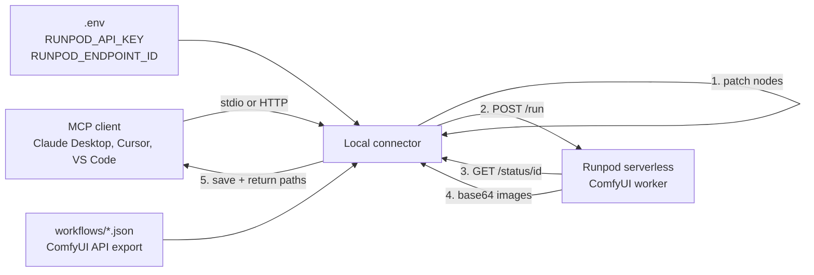

# runpod-comfyui-mcp

A local [MCP](https://modelcontextprotocol.io) connector that runs a ComfyUI workflow
on a [Runpod](https://www.runpod.io) serverless GPU endpoint.

The connector runs on your machine. It owns the workflow JSON, patches the parameters
you ask for, submits the job to Runpod, polls it, and saves the result. The GPU only
ever receives a finished job payload — it never needs your local files or your models.

The bundled example is a **Krea2 Turbo text-to-image** workflow (8 steps, CFG 1), but
the template is generic: point `WORKFLOW_PATH` at any ComfyUI **API-format** workflow
and adjust the node mapping.

---

## How it works



1. **Prepare** — the template is loaded, node ids are resolved (by id, then by
   `class_type`), and only the requested inputs are written.
2. **Submit** — `POST https://api.runpod.ai/v2/{endpoint}/run` with the workflow inside
   `input.workflow`.
3. **Poll** — `GET /status/{job_id}` until `COMPLETED`, `FAILED`, or the timeout.
4. **Save** — base64 (or S3) outputs are decoded into `output/` with safe filenames.
5. **Answer** — the tool returns local paths, plus HTTP URLs when running in HTTP mode.

---

## Requirements

- Python 3.10+
- A Runpod account with a **serverless** endpoint running a ComfyUI worker
  ([runpod-workers/worker-comfyui](https://github.com/runpod-workers/worker-comfyui))
  that has the models referenced by your workflow.
- A Runpod API key: <https://www.runpod.io/console/user/settings> → *API Keys*

---

## Quickstart

```bash
git clone https://github.com/haughtai-jared/localConnector_runpod_comfyui.git
cd localConnector_runpod_comfyui

python -m venv .venv
# Windows: .venv\Scripts\activate
source .venv/bin/activate

pip install -e .

cp .env.example .env      # Windows: copy .env.example .env
# edit .env and paste RUNPOD_API_KEY + RUNPOD_ENDPOINT_ID
```

Validate everything before spending GPU time:

```bash
runpod-comfyui-mcp --check
```

```
{
  "config": { "runpod_endpoint_id": "abc123def456", "runpod_api_key": "rpa_…cdef", ... },
  "workflow": { "valid": true, "nodes": { "sampler": "53", "save": "29", ... } },
  "endpoint": { "reachable": true, "health": { "workers": { "idle": 1, "running": 0 } } }
}
```

Then run the server:

```bash
# stdio — the normal mode for desktop MCP clients
runpod-comfyui-mcp

# or HTTP + OpenAI-compatible shim on http://127.0.0.1:8600
runpod-comfyui-mcp --transport streamable-http
```

---

## Configuration

Everything is environment-driven. `python-dotenv` loads `.env` from the working
directory (or the repo root), but **real environment variables always win**, so a
client that injects secrets overrides the file.

| Variable | Required | Default | Purpose |
|---|---|---|---|
| `RUNPOD_API_KEY` | ✅ | — | Runpod API key. Never logged; masked everywhere it is shown. |
| `RUNPOD_ENDPOINT_ID` | ✅ | — | Serverless endpoint id (the part after `/v2/`). |
| `RUNPOD_BASE_URL` | | `https://api.runpod.ai/v2` | Change only when proxying Runpod. |
| `RUNPOD_JOB_TIMEOUT_S` | | `900` | Wall-clock budget per render, including cold start. |
| `RUNPOD_POLL_INTERVAL_S` | | `2` | Delay between status polls. |
| `RUNPOD_OUTPUT_DIR` | | `./output` | Where rendered files are written. |
| `WORKFLOW_PATH` | | `workflows/krea2_turbo_t2i.json` | ComfyUI API-format workflow. |
| `MCP_TRANSPORT` | | `stdio` | `stdio` or `streamable-http`. |
| `MCP_HOST` / `MCP_PORT` | | `127.0.0.1` / `8600` | HTTP bind address (HTTP mode only). |
| `MCP_PUBLIC_BASE_URL` | | — | Public URL used to build media links behind a tunnel. |
| `LOG_LEVEL` | | `INFO` | `DEBUG`, `INFO`, `WARNING`, `ERROR`. |

Precedence: CLI flag → environment variable → `.env` → built-in default.

---

## Connect a client

### Claude Desktop

`claude_desktop_config.json` — see [examples/claude_desktop_config.json](examples/claude_desktop_config.json).

```json
{
  "mcpServers": {
    "runpod-comfyui": {
      "command": "C:/path/to/localConnector_runpod_comfyui/.venv/Scripts/python.exe",
      "args": ["-m", "runpod_comfyui_mcp"],
      "env": {
        "RUNPOD_API_KEY": "your-key",
        "RUNPOD_ENDPOINT_ID": "your-endpoint-id"
      }
    }
  }
}
```

The connector reads `.env` from its working directory, so you can omit `env` and keep
the secrets in `.env` instead.

### VS Code

`.vscode/mcp.json` — see [examples/vscode_mcp.json](examples/vscode_mcp.json).

### Any MCP client over HTTP

```
POST http://127.0.0.1:8600/mcp        # streamable HTTP, JSON responses
```

### OpenAI-compatible clients

```bash
curl -s http://127.0.0.1:8600/v1/chat/completions \
  -H 'Content-Type: application/json' \
  -d '{"model":"runpod-krea2-turbo","messages":[
        {"role":"user","content":"a red fox in fresh snow, golden hour, 35mm photo"}]}'
```

The reply is an OpenAI-shaped envelope whose `message.images[0]` is the base64 image
and whose content lists links to `/media/<file>`.

---

## Tools

### `generate_image`

Renders one image and blocks until it is saved.

| Parameter | Type | Notes |
|---|---|---|
| `prompt` | string | **Required.** Written to the positive `CLIPTextEncode`. |
| `negative_prompt` | string | Ignored by the bundled template (see below). |
| `width`, `height` | int | 64–4096. `EmptyLatentImage` defaults are 1344×768. |
| `steps`, `cfg` | int / float | Krea2 Turbo is tuned for 8 steps, CFG 1.0. |
| `sampler`, `scheduler` | string | e.g. `euler` / `simple`. |
| `seed` | int | Follows links to a `PrimitiveInt` node automatically. |
| `lora_strength` | float | Applied to every `LoraLoaderModelOnly` node. |
| `filename_prefix` | string | Sanitised; written to `SaveImage`. |
| `timeout_s` | float | Overrides `RUNPOD_JOB_TIMEOUT_S` for this call. |

Returns:

```json
{
  "ok": true,
  "images": [
    { "filename": "image_00042_.png", "path": "…/output/image_00042_.png",
      "mime_type": "image/png", "bytes": 1582391,
      "url": "http://127.0.0.1:8600/media/image_00042_.png" }
  ],
  "job": { "id": "…", "status": "COMPLETED", "execution_time_s": 4.2, "delay_time_s": 0.3 },
  "workflow": { "nodes": { "sampler": "53", "save": "29" }, "patches": [], "warnings": [] }
}
```

Failures return `{"ok": false, "error": "...", ...}` instead of raising, so a model can
read the message and correct itself.

### `check_setup`

Validates credentials, the workflow mapping, and (optionally) the endpoint's
`/health`. Costs no GPU time. Never prints the raw API key.

### `cancel_job`

Cancels a queued or running job by id.

---

## The workflow template

The file in `workflows/` must be a **ComfyUI API export** (*Workflow → Export (API)*),
not the UI export — that is the only format a serverless worker accepts. Point at a
different file with `WORKFLOW_PATH`.

Node ids are not stable across re-saves, so the connector resolves every node twice:
first the id it expects, then the first node of the right `class_type`. Nothing is
hard-coded to a position.

Mapping for `workflows/krea2_turbo_t2i.json`:

| Node | `class_type` | Receives |
|---|---|---|
| `51` | `CLIPTextEncode` | `prompt` |
| `52` | `EmptyLatentImage` | `width`, `height` |
| `53` | `KSampler` | `steps`, `cfg`, `sampler_name`, `scheduler`, `seed` |
| `120` | `PrimitiveInt` | `seed` (KSampler's seed is *linked* to it) |
| `99` | `LoraLoaderModelOnly` | `lora_strength` |
| `29` | `SaveImage` | `filename_prefix` |

Notes:

- **`negative_prompt` is unavailable in this template.** Its sampler's `negative` input
  is a `ConditioningZeroOut` wrapping the same positive encode. The connector detects
  that and returns a warning rather than silently doing nothing. To enable it, add a
  second `CLIPTextEncode` and wire it to the sampler's `negative` input.
- **Model filenames must exist on the worker**: `krea2/krea2_turbo_int8_convrot.safetensors`,
  `krea2/qwen3vl_4b_fp8_scaled.safetensors`, `qwen_image_vae.safetensors`, and the
  realism LoRA. Edit the JSON, or install the same models in your endpoint image.
- **Use forward slashes** in model paths; the worker runs on Linux.
- Any `LoadImage` node can be fed from local files — `workflow.attach_images()` embeds
  the bytes and rewrites the node to the matching placeholder name. The bundled
  text-to-image graph has no `LoadImage`, so that path is unused but ready.

### What the worker receives

```json
{
  "input": {
    "workflow": { "29": { "class_type": "SaveImage", "inputs": { … } }, … },
    "images": [{ "name": "input_170.png", "image": "<base64>" }],
    "output_type": "base64"
  }
}
```

This is the contract used by `runpod-workers/worker-comfyui`. Set `output_type` to
`"s3"` and adapt `outputs.py` if you prefer bucket URLs.

---

## Project layout

```
├── .env.example                  # every setting, documented, no secrets
├── examples/                     # client configuration snippets
├── src/runpod_comfyui_mcp/
│   ├── cli.py                    # argument parsing, --check, transport selection
│   ├── config.py                 # env/.env loading, validation, secret masking
│   ├── runpod.py                 # /run, /status, /cancel, /health with retries
│   ├── workflow.py               # node resolution + parameter patching
│   ├── outputs.py                # base64 / S3 result decoding and safe filenames
│   └── server.py                 # MCP tools, HTTP routes, OpenAI shim
├── tests/                        # offline tests; no Runpod account needed
└── workflows/krea2_turbo_t2i.json
```

---

## Tests

```bash
pip install -e ".[dev]"
pytest
```

The suite is fully offline: Runpod is replaced by `httpx.MockTransport`, and the stdio
test drives the real entry point as a subprocess.

---

## Troubleshooting

| Symptom | Cause / fix |
|---|---|
| `RUNPOD_API_KEY is not set` | No `.env`, or the key is empty. Run `runpod-comfyui-mcp --check`. |
| `Runpod rejected the API key (HTTP 401)` | Key is wrong or revoked. The message shows a masked key so you can confirm which one is loaded. |
| `Endpoint '…' was not found (HTTP 404)` | Wrong `RUNPOD_ENDPOINT_ID`, or the endpoint is not deployed. |
| `did not finish within …s` | Cold start + big model. Raise `RUNPOD_JOB_TIMEOUT_S`; the job is cancelled on timeout. |
| `completed but no image could be saved` | The worker returned an unexpected shape, or the graph has no `SaveImage`. Check the worker logs in Runpod. |
| `no SaveImage node` | Your template has no `SaveImage` — the job would produce nothing. |
| `negative_prompt was ignored` | Expected for the bundled template (see above). |
| `workflow … is a ComfyUI *UI* export` | Re-export with *Workflow → Export (API)*. |
| Model not found on the worker | The `.safetensors` names in the workflow must match the endpoint image. |

---

## Security notes

- `.env` is git-ignored; `.env.example` contains no real values. Never commit a key.
- The API key is only ever sent to `RUNPOD_BASE_URL`, in an `Authorization` header.
  It is never written to logs, tool results, or the HTML page — `mask_secret()` is the
  only way it is rendered.
- HTTP mode binds `127.0.0.1` by default. If you expose it through a tunnel, put
  authentication in front of it: the `/media` route serves whatever is in the output
  folder, and the OpenAI shim spends real GPU money.
- `cancel_job` and `generate_image` accept ids and values from the model; both are
  validated and the pure functions under `src/` never touch the network except through
  `runpod.py` and `outputs.download()` (which refuses anything but `http`/`https`).

---

## License

MIT — see [LICENSE](LICENSE).

Krea2, ComfyUI and Runpod are the property of their respective owners. This
repository ships no model weights, no credentials and no third-party code.
