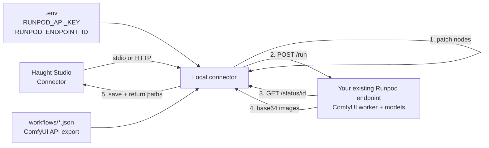

# runpod-comfyui-mcp

A local [MCP](https://modelcontextprotocol.io) connector that runs a ComfyUI workflow
on a [Runpod](https://www.runpod.io) serverless GPU endpoint.

The connector runs on your machine. It owns the workflow JSON, patches the parameters
you ask for, submits the job to Runpod, polls it, and saves the result. The GPU only
ever receives a finished job payload — it never needs your local files.

The bundled example is a **Krea2 Turbo text-to-image** workflow (8 steps, CFG 1), but
the template is generic: point `WORKFLOW_PATH` at any ComfyUI **API-format** workflow
and change the node mapping.

> **This repo assumes you already have a Runpod worker running ComfyUI with everything
> your workflow needs installed** — models, LoRAs, VAEs, custom nodes, and the ComfyUI
> version the graph was built against. Nothing here builds a container image, downloads
> weights, installs ComfyUI, or deploys an endpoint. You bring a working endpoint and
> its id; this project is only the local half.

---

## The core idea: node mapping

Everything else is plumbing. The part that actually makes a workflow controllable is the
**mapping between workflow nodes and the tool inputs the model can set.**

A ComfyUI graph is a set of nodes, each with a `class_type` and an `inputs` map. Some of
those inputs are literals (`"steps": 8`, `"text": "..."`); others are links to another
node (`"model": ["55", 0]`). Any literal input on any node is something the model could
control — you just have to decide which ones to expose, and where:

```
workflow node + input        →  tool parameter        →  what the model sends
─────────────────────────────────────────────────────────────────────────────
51 CLIPTextEncode.text       →  prompt               →  "a red fox in fresh snow"
52 EmptyLatentImage.width    →  width                →  1024
53 KSampler.steps            →  steps                →  8
120 PrimitiveInt.value       →  seed                 →  12345   (KSampler.seed links to it)
29 SaveImage.filename_prefix →  filename_prefix      →  "fox"
```

The workflow builder then copies the template, writes only the values it was given,
leaves every other node untouched, and sends the completed graph to Runpod. The worker
runs it as-is — it has no idea the parameters came from a conversation.

Concretely, adding a capability is three steps:

1. **Pick the node input** in your workflow JSON that should be model-controlled.
2. **Write it** in `prepare_text_to_image()` in [workflow.py](src/runpod_comfyui_mcp/workflow.py)
   with `set_input()` (literal values) or `set_scalar()` (values that may be wired to a
   primitive node).
3. **Expose it** as a parameter on `generate_image()` in [server.py](src/runpod_comfyui_mcp/server.py).

Nothing else changes. Anything you do *not* map keeps the template's value, which is why
a caller can just send a prompt and still get a sane image.

---

## How it works



1. **Prepare** — the template is loaded, node ids are resolved (by id, then by
   `class_type`), and only the mapped inputs are written. Everything unmapped is sent
   exactly as the template had it.
2. **Submit** — `POST https://api.runpod.ai/v2/{endpoint}/run` with the workflow inside
   `input.workflow`.
3. **Poll** — `GET /status/{job_id}` until `COMPLETED`, `FAILED`, or the timeout.
4. **Save** — base64 (or S3) outputs are decoded into `output/` with safe filenames.
5. **Answer** — the tool returns local paths, plus HTTP URLs when running in HTTP mode.

---

## Requirements

**The Runpod side is your responsibility.** This repo does not create, configure, or
provision it. You need:

- A Runpod account with a deployed **serverless** endpoint running a ComfyUI worker
  ([runpod-workers/worker-comfyui](https://github.com/runpod-workers/worker-comfyui)).
- That worker image must already contain **every file the workflow references**: base
  checkpoints/UNETs, CLIP/text encoders, VAEs, LoRAs, upscalers, controlnets, and any
  custom node packages the graph uses — all at the paths written in the workflow JSON
  (forward slashes, Linux layout).
- Enough GPU VRAM and disk for the models, and a cold start you are willing to wait for.

If the worker is missing a model or node, the job fails on the Runpod side and the
connector surfaces the worker's error. That is a worker problem, not a connector problem
— fix it by updating the endpoint image or the workflow's file paths.

On your machine you need:

- Python 3.10+
- A Runpod API key: <https://www.runpod.io/console/user/settings> → *API Keys*

---

## Quickstart

```bash
git clone https://github.com/haughtai-jared/localConnector_runpod_comfyui.git
cd localConnector_runpod_comfyui

python -m venv .venv
# Windows: .venv\Scripts\activate
source .venv/bin/activate

pip install -e .

cp .env.example .env      # Windows: copy .env.example .env
# edit .env and paste RUNPOD_API_KEY + RUNPOD_ENDPOINT_ID
```

Validate everything before spending GPU time:

```bash
runpod-comfyui-mcp --check
```

```
{
  "config": { "runpod_endpoint_id": "abc123def456", "runpod_api_key": "rpa_...cdef", ... },
  "workflow": { "valid": true, "nodes": { "sampler": "53", "save": "29", ... } },
  "endpoint": { "reachable": true, "health": { "workers": { "idle": 1, "running": 0 } } }
}
```

Then run the server:

```bash
# HTTP — how Haught Studio reaches the Connector
runpod-comfyui-mcp --transport streamable-http

# or stdio, if Haught Studio launches the connector itself
runpod-comfyui-mcp
```

---

## Configuration

Everything is environment-driven. `python-dotenv` loads `.env` from the working
directory (or the repo root), but **real environment variables always win**, so a
client that injects secrets overrides the file.

| Variable | Required | Default | Purpose |
|---|---|---|---|
| `RUNPOD_API_KEY` | ✅ | — | Runpod API key. Never logged; masked everywhere it is shown. |
| `RUNPOD_ENDPOINT_ID` | ✅ | — | Serverless endpoint id (the part after `/v2/`). |
| `RUNPOD_BASE_URL` | | `https://api.runpod.ai/v2` | Change only when proxying Runpod. |
| `RUNPOD_JOB_TIMEOUT_S` | | `900` | Wall-clock budget per render, including cold start. |
| `RUNPOD_POLL_INTERVAL_S` | | `2` | Delay between status polls. |
| `RUNPOD_OUTPUT_DIR` | | `./output` | Where rendered files are written. |
| `WORKFLOW_PATH` | | `workflows/krea2_turbo_t2i.json` | ComfyUI API-format workflow. |
| `MCP_TRANSPORT` | | `stdio` | `stdio` or `streamable-http` (Haught Studio over HTTP). |
| `MCP_HOST` / `MCP_PORT` | | `127.0.0.1` / `8600` | HTTP bind address (HTTP mode only). |
| `MCP_PUBLIC_BASE_URL` | | — | Public URL used to build media links behind a tunnel. |
| `LOG_LEVEL` | | `INFO` | `DEBUG`, `INFO`, `WARNING`, `ERROR`. |

Precedence: CLI flag → environment variable → `.env` → built-in default.

---

## Connect Haught Studio

Haught Studio talks to this process as a **Connector**. Run the connector, then point
the Connector at it. See [examples/haughtstudio_connector.json](examples/haughtstudio_connector.json)
for a starting point.

### HTTP (recommended)

```bash
runpod-comfyui-mcp --transport streamable-http --port 8600
```

| Setting | Value |
|---|---|
| URL | `http://127.0.0.1:8600/mcp` |
| Transport | streamable HTTP, JSON responses |
| Model id | `runpod-krea2-turbo` |

The same server also exposes `/v1/models` and `/v1/chat/completions`, which is the shape
Haught Studio uses for a simple prompt-in / image-back connector:

```bash
curl -s http://127.0.0.1:8600/v1/chat/completions \
  -H 'Content-Type: application/json' \
  -d '{"model":"runpod-krea2-turbo","messages":[
        {"role":"user","content":"a red fox in fresh snow, golden hour, 35mm photo"}]}'
```

The reply carries the image in `message.images[0]` (base64) and lists links to
`/media/<file>` in the message content.

### stdio

If Haught Studio starts the connector as a child process instead:

```bash
.venv/bin/python -m runpod_comfyui_mcp
```

The connector reads `.env` from its working directory, so the Runpod secrets can live
there rather than in Haught Studio's connector settings.

---

## Tools

### `generate_image`

Renders one image and blocks until it is saved.

| Parameter | Type | Notes |
|---|---|---|
| `prompt` | string | **Required.** Written to the positive `CLIPTextEncode`. |
| `negative_prompt` | string | Ignored by the bundled template (see below). |
| `width`, `height` | int | 64–4096. `EmptyLatentImage` defaults are 1344×768. |
| `steps`, `cfg` | int / float | Krea2 Turbo is tuned for 8 steps, CFG 1.0. |
| `sampler`, `scheduler` | string | e.g. `euler` / `simple`. |
| `seed` | int | Follows links to a `PrimitiveInt` node automatically. |
| `lora_strength` | float | Applied to every `LoraLoaderModelOnly` node. |
| `filename_prefix` | string | Sanitised; written to `SaveImage`. |
| `timeout_s` | float | Overrides `RUNPOD_JOB_TIMEOUT_S` for this call. |

Returns:

```json
{
  "ok": true,
  "images": [
    { "filename": "image_00042_.png", "path": "…/output/image_00042_.png",
      "mime_type": "image/png", "bytes": 1582391,
      "url": "http://127.0.0.1:8600/media/image_00042_.png" }
  ],
  "job": { "id": "…", "status": "COMPLETED", "execution_time_s": 4.2, "delay_time_s": 0.3 },
  "workflow": { "nodes": { "sampler": "53", "save": "29" }, "patches": [], "warnings": [] }
}
```

Failures return `{"ok": false, "error": "...", ...}` instead of raising, so a model can
read the message and correct itself.

### `check_setup`

Validates credentials, the workflow mapping, and (optionally) the endpoint's
`/health`. Costs no GPU time. Never prints the raw API key.

### `cancel_job`

Cancels a queued or running job by id.

---

## Adapting the template to your own workflow

The file in `workflows/` must be a **ComfyUI API export** (*Workflow → Export (API)*),
not the UI export — that is the only format a serverless worker accepts. Point at a
different file with `WORKFLOW_PATH`.

Remember the assumption from [Requirements](#requirements): the workflow you point at
must be runnable on your endpoint *before* you wire up any parameters. Export a graph
that works in the cloud worker first, then decide which of its inputs the model may
touch.

Node ids are not stable across re-saves, so the connector resolves every node twice:
first the id it expects, then the first node of the right `class_type`. Nothing is
hard-coded to a position, which is why a renumbered workflow usually still works.

### Current mapping

Mapping for `workflows/krea2_turbo_t2i.json`:

| Node | `class_type` | Receives |
|---|---|---|
| `51` | `CLIPTextEncode` | `prompt` |
| `52` | `EmptyLatentImage` | `width`, `height` |
| `53` | `KSampler` | `steps`, `cfg`, `sampler_name`, `scheduler`, `seed` |
| `120` | `PrimitiveInt` | `seed` (KSampler's seed is *linked* to it) |
| `99` | `LoraLoaderModelOnly` | `lora_strength` |
| `29` | `SaveImage` | `filename_prefix` |

### Adding your own parameter

Say you want the model to choose the sampler's `denoise`. Find the node that owns it:

```json
"53": { "class_type": "KSampler", "inputs": { "denoise": 1, ... } }
```

Then expose it, in three places:

```python
# 1. workflow.py — declare it on the parameter object
@dataclass
class TextToImageParams:
    ...
    denoise: float | None = None

# 2. workflow.py — write it into the graph (set_scalar if it might be linked)
if params.denoise is not None:
    applied, where, note = set_scalar(workflow, sampler_id, "denoise", float(params.denoise))
    patches.append(Patch("denoise", where, applied, note))

# 3. server.py — surface it on the tool so the model can send it
@server.tool()
def generate_image(prompt: str, ..., denoise: float | None = None) -> dict:
    return generate(prompt=prompt, ..., denoise=denoise)
```

Add the matching clamp in `generate()` and the field to the chat route's `allowed`
tuple if you want Haught Studio to reach it through `/v1/chat/completions` too. Every
change is recorded in the `workflow.patches` block of the response, so a caller can see
exactly what was applied and what was silently refused.

**A node input left unmapped is not a bug** — it just keeps the template's value. Map
only what the model should be allowed to change; everything else stays under your
control.

### Notes on the bundled template

- **`negative_prompt` is unavailable in this template.** Its sampler's `negative` input
  is a `ConditioningZeroOut` wrapping the same positive encode. The connector detects
  that and returns a warning rather than silently doing nothing. To enable it, add a
  second `CLIPTextEncode` and wire it to the sampler's `negative` input.
- **Model filenames must exist on the worker** (see
  [Requirements](#requirements)): `krea2/krea2_turbo_int8_convrot.safetensors`,
  `krea2/qwen3vl_4b_fp8_scaled.safetensors`, `qwen_image_vae.safetensors`, and the
  realism LoRA. Edit the JSON, or install the same models in your endpoint image.
- **Use forward slashes** in model paths; the worker runs on Linux.
- Any `LoadImage` node can be fed from local files — `workflow.attach_images()` embeds
  the bytes and rewrites the node to the matching placeholder name. The bundled
  text-to-image graph has no `LoadImage`, so that path is unused but ready.

### What the worker receives

```json
{
  "input": {
    "workflow": { "29": { "class_type": "SaveImage", "inputs": { … } }, … },
    "images": [{ "name": "input_170.png", "image": "<base64>" }],
    "output_type": "base64"
  }
}
```

This is the contract used by `runpod-workers/worker-comfyui`. Set `output_type` to
`"s3"` and adapt `outputs.py` if you prefer bucket URLs.

---

## Project layout

```
├── .env.example                  # every setting, documented, no secrets
├── examples/                     # Haught Studio connector configuration
├── src/runpod_comfyui_mcp/
│   ├── cli.py                    # argument parsing, --check, transport selection
│   ├── config.py                 # env/.env loading, validation, secret masking
│   ├── runpod.py                 # /run, /status, /cancel, /health with retries
│   ├── workflow.py               # node resolution + parameter patching
│   ├── outputs.py                # base64 / S3 result decoding and safe filenames
│   └── server.py                 # MCP tools, HTTP routes, chat route
├── tests/                        # offline tests; no Runpod account needed
└── workflows/krea2_turbo_t2i.json
```

---

## Tests

```bash
pip install -e ".[dev]"
pytest
```

The suite is fully offline: Runpod is replaced by `httpx.MockTransport`, and the stdio
test drives the real entry point as a subprocess.

---

## Troubleshooting

| Symptom | Cause / fix |
|---|---|
| `RUNPOD_API_KEY is not set` | No `.env`, or the key is empty. Run `runpod-comfyui-mcp --check`. |
| `Runpod rejected the API key (HTTP 401)` | Key is wrong or revoked. The message shows a masked key so you can confirm which one is loaded. |
| `Endpoint '…' was not found (HTTP 404)` | Wrong `RUNPOD_ENDPOINT_ID`, or the endpoint is not deployed. |
| `did not finish within …s` | Cold start + big model. Raise `RUNPOD_JOB_TIMEOUT_S`; the job is cancelled on timeout. |
| `completed but no image could be saved` | The worker returned an unexpected shape, or the graph has no `SaveImage`. Check the worker logs in Runpod. |
| `no SaveImage node` | Your template has no `SaveImage` — the job would produce nothing. |
| `negative_prompt was ignored` | Expected for the bundled template: its negative conditioning is zeroed. Map a second `CLIPTextEncode` if you need it. |
| `workflow … is a ComfyUI *UI* export` | Re-export with *Workflow → Export (API)*. |
| Model not found on the worker | The `.safetensors` names in the workflow must match what your endpoint image actually has installed. Fix the image or the JSON — the connector cannot see inside the worker. |
| A parameter is silently ignored | That node input is not mapped yet, or the template has no such node. Check `workflow.patches` in the response, or run `check_setup`. |

---

## Security notes

- `.env` is git-ignored; `.env.example` contains no real values. Never commit a key.
- The API key is only ever sent to `RUNPOD_BASE_URL`, in an `Authorization` header.
  It is never written to logs, tool results, or the HTML page — `mask_secret()` is the
  only way it is rendered.
- HTTP mode binds `127.0.0.1` by default. If you expose it through a tunnel, put
  authentication in front of it: the `/media` route serves whatever is in the output
  folder, and every generation call spends real GPU money.
- `cancel_job` and `generate_image` accept ids and values from the model; both are
  validated and the pure functions under `src/` never touch the network except through
  `runpod.py` and `outputs.download()` (which refuses anything but `http`/`https`).

---

## License

MIT — see [LICENSE](LICENSE).

Krea2, ComfyUI and Runpod are the property of their respective owners. This
repository ships no model weights, no credentials and no third-party code.
